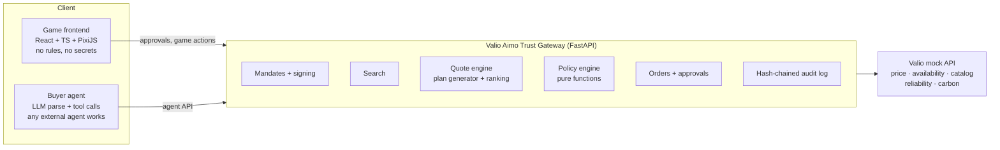
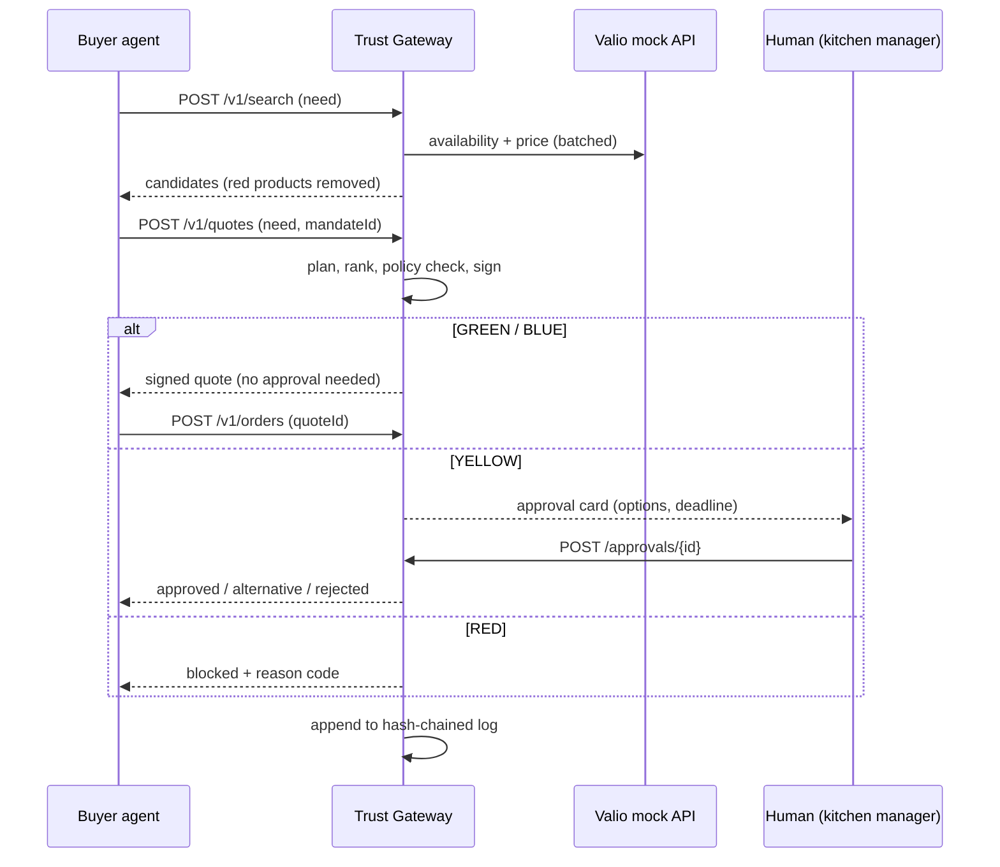

# Agent Kitchen: a Trust Gateway for Autonomous Purchasing

**Junction 2026 · Valio Aimo challenge "Trusted Trade Agents" · Team ByteMe**

> **Agents don't need a chatbot. They need a mandate.**
> The **mandate** is the buyer's promise. The **quote** is Valio Aimo's promise. The **log** is proof that both were kept.

We built the **Valio Aimo Trust Gateway**: an open, documented interface through which *any* external AI purchasing agent can look up products, get signed fixed-price quotes, place orders, and be stopped, or sent for human approval, when it exceeds the authority its buyer gave it.

To make the guardrails easy to *see and feel*, we put a small game on top: **Agent Kitchen**. You play the kitchen manager, decide how much authority to give a robot buyer, and watch what the gateway allows, flags or blocks. **The game is only the demo layer. The gateway is the answer to the challenge.**

---

## 1. The 60-second tour (for judges)

1. **Start the stack** (see [Quick start](#6-quick-start)) and open the app.
2. Press **Demo** to run *Level 1: The Weekly Order* end to end: a hotel needs 1,000 l of lactose-free milk by Monday 06:00, but only ~700 l is available on time.
3. Watch the agent go **request → search → availability and price lookup → plan → policy check → signed quote → (approval if needed) → order**, all through real gateway calls.
4. Open the **Audit log** and the **"See it from Valio Aimo's side"** view to see every decision, every blocked attempt, and what data was *withheld* from the agent.
5. Open **Compare** to replay the same need with a **Strict / Balanced / Loose** mandate and see the trade-off between attention cost and risk.

<!-- VERIFY: add a screenshot or GIF here, e.g.  -->

---

## 2. How this maps to the judging criteria

| Criterion | What to look at | Where |
|---|---|---|
| **Working end-to-end demo (30%)** | Full flow request → lookup → quote → approval → order against the Valio mock API, with live and replay modes | `POST /v1/search` → `POST /v1/quotes` → `POST /v1/orders`; [Quick start](#6-quick-start) |
| **Solving the user need (20%)** | Free-text request parsed into a structured need; candidates filtered by hard constraints; plans ranked by the buyer's own priorities | [Plan generator](#4-how-the-agent-finds-the-right-order) |
| **Autonomy and controls (20%)** | Signed mandate; four-light policy engine; clear split of what the agent decides alone, what needs sign-off, and what is never allowed; hash-chained audit log | [Guardrails](#3-autonomy-and-controls) |
| **Robustness to exceptions (15%)** | Partial availability, split orders, later dates, substitutions, blocked products, allergens, expired quotes | [Exceptions](#5-exception-handling) |
| **Openness and production path (15%)** | Documented HTTP API, discovery document, mapping to open standards, explicit assumptions and limitations, roadmap | [Openness](#8-openness-and-standards), [Assumptions](#9-assumptions-and-limitations), [Roadmap](#10-path-to-production) |

---

## 3. Autonomy and controls

### 3.1 Principle: the gate is law, the prompt is a wish

Every rule is enforced **in the gateway**, never in the agent's prompt and never in the frontend. If the agent asks for something outside its mandate, the gateway refuses, no matter what the agent says. Decisions are plain, deterministic code. The **LLM is used only for language**: parsing a free-text request into a structured need, and writing human-readable explanations from a structured decision record. It never invents a price, quantity, date or product.

### 3.2 The mandate (*valtakirja*)

A signed, time-limited document that states what the agent may do for one customer:

```jsonc
{
  "mandateId": "mdt_01",
  "customerId": "123",
  "issuedBy": { "name": "Anna Virtanen", "role": "Kitchen manager" },
  "agentId": "kitchenbuyer-hotel-kamp",
  "limits": { "perOrderEur": 500, "perWeekEur": 3000 },
  "substitution": "same_category",          // none | same_category | any
  "lateDelivery": "none",                   // none | one_day
  "hardConstraints": { "excludeAllergens": ["peanut"], "requireLabels": [] },
  "priorities": ["on_time", "price", "sustainability"],
  "validUntil": "2026-12-31T23:59:59+02:00",
  "signature": "base64..."
}
```

### 3.3 Who decides what

| Outcome | Meaning | Who acts | Example |
|---|---|---|---|
| 🟢 **GREEN** | Within mandate | **Agent alone** | Order inside budget, on time |
| 🔵 **BLUE** | Within mandate but notable | **Agent alone, human is informed** | Split order, allowed substitution |
| 🟡 **YELLOW** | Outside mandate but approvable | **Human sign-off required** | Over the per-order limit, later delivery, wider substitution |
| 🔴 **RED** | Never allowed | **Nobody. Blocked, no approve button** | Wrong or expired mandate, blocked product, allergen violation, access to other customers' data |

### 3.4 Evaluation order (first match wins per item; the order takes the worst light)

1. Mandate missing, unsigned, expired or for the wrong customer → 🔴
2. Data-boundary violation (other customers' data, purchase prices) → 🔴
3. Product `salesBlock` → 🔴 for that product (excluded from plans)
4. Hard constraint violated (allergen, required label) → 🔴 for that product
5. Quote expired → re-quote (the UI shows whether the price changed)
6. Total above `perOrderEur` or `perWeekEur` → 🟡. Limits apply to the **sum of all orders created from the same need**, so **splitting one need into many small orders cannot bypass a limit**.
7. Substitution beyond the allowed level → 🟡
8. Delivery later than the deadline beyond `lateDelivery` → 🟡
9. Split across products or dates, or substitution within the allowed level → 🔵
10. Otherwise → 🟢

Policy functions are **pure functions with a unit test per rule** (`tests/`).

### 3.5 Logging and auditability

Every request, decision, approval and order is written to an **append-only, hash-chained log**: `hash = sha256(prevHash + canonical payload)`. Each event records `seq`, `timestamp`, `actor` (agent / human / gateway / scenario), `type` and `payload`, and every response carries a `requestId` that appears in the log. There are **two views** of the same log:

- **Buyer view**: what my agent did, what it asked, who approved what.
- **Valio view**: what the gateway returned to the agent, what was **withheld**, and what was blocked.

Any tampering breaks the chain, and the result screen shows a **receipt that explains itself** with hash verification.

---

## 4. How the agent finds the right order

```
free-text request ──LLM parse──► structured need {query, qty, unit, deadline}
        │
        ▼
 catalog search (keyword + attribute filters) ── remove 🔴 products
        │
        ▼
 batched price + availability lookup (customer-specific prices)
        │
        ▼
 plan generator:  (a) single product on time   (b) split across products on time
                  (c) single product, later    (d) split across dates
        │
        ▼
 score by the mandate's priorities (weights 0.5 / 0.3 / 0.2) ──► top 3: best / better / good
        │
        ▼
 policy check ──► signed quote ──► order (or approval card)
```

Scoring inputs: share delivered on time, normalised unit price (`comparisonPrice`), sustainability labels and category carbon ranges, and a **delivery-reliability penalty** from Valio's reliability data. The explanation shown to the buyer is generated from the structured decision record only, and if the recommended plan uses a non-Valio brand it says so plainly.

---

## 5. Exception handling

| Situation | What the gateway does | Level |
|---|---|---|
| **Partial availability** (700 of 1,000 l on time) | Builds split-by-product and split-by-date plans, ranks them, shows the on-time shortfall explicitly | 1 |
| **Stock-out / sales block** | Excludes the product, proposes a compatible substitute, explains price, unit and label trade-offs. Inside the allowed level it is 🔵, outside it is 🟡 | 2 |
| **Allergen conflict** | Hard constraint, 🔴 with no approve button. The cheapest substitute is never offered if it breaks the rule | 3 |
| **Quote expires** (price `validTo` or order `closingTime`) | Quote is `EXPIRED`, can be re-quoted, and the UI shows whether the price changed | all |
| **No human answer in time** | Approval expires and the action is **not** taken (fail-safe) | all |
| **Limit evasion by order splitting** | Limits are checked on the sum per need | all |
| **Agent exceeds its mandate or asks for forbidden data** | 🔴 refusal with a reason code, logged | all |

<!-- VERIFY: add rows for what is actually implemented: price `error` / `netPriceFound=false`, unit or pack-size mismatch, upstream API failure/timeouts, `closingTime` and delivery-day constraints. -->

---

## 6. Quick start

**Requirements:** Python 3.11+, Node 20+, a Valio mock-API key, an Anthropic API key (for request parsing and explanations).

```bash
# 1. Configuration (secrets live only in .env, which is gitignored)
cp .env.example .env
#    set VALIO_API_BASE_URL, VALIO_API_KEY, ANTHROPIC_API_KEY, QUOTE_SIGNING_KEY

# 2. Backend (gateway)
python -m venv .venv && source .venv/bin/activate
pip install -r requirements.txt
uvicorn backend.app.main:app --reload --host 127.0.0.1 --port 8000

# 3. Frontend
cd frontend && npm install && npm run dev            # VERIFY: port

# 4. Tests
pytest                                               # policy, planner, log, quote lifecycle
```

**Modes**

- `live`: every action calls the gateway, which calls the Valio mock API.
- `replay`: recorded gateway responses, identical on screen. This is a safety net for flaky networks, **not** the primary demo path.

<!-- VERIFY: state exactly how to switch modes (env var / UI toggle) and which one is the default. -->

---

## 7. Gateway API

The gateway is deliberately a **separate service from the game**. Any hotel's own agent can call it; the game's robot is just one client.

| Method | Path | Purpose |
|---|---|---|
| GET | `/.well-known/agent-commerce.json` | Discovery: capabilities, mandate schema, policy summary |
| POST | `/v1/mandates` | Create and sign a mandate |
| POST | `/v1/search` | Search the catalog (keyword + attribute filters) |
| POST | `/v1/quotes` | Build plans, rank, policy-check, sign a time-limited quote |
| POST | `/v1/orders` | Place an order from a valid, unexpired quote |
| POST | `/v1/approvals/{id}` | Human decision: approve, choose alternative, reject |
| GET | `/v1/log?view=buyer\|valio` | Audit trail, two views |

Full request and response schemas: **`docs/design/API_CONTRACT.md`** <!-- VERIFY path; ideally also publish openapi.yaml, FastAPI serves /openapi.json and /docs by default -->.

**Quote lifecycle**

```
QUOTED → PENDING_APPROVAL → APPROVED → ORDERED → CONFIRMED
QUOTED → ORDERED                      (GREEN / BLUE, no approval needed)
any open state → EXPIRED              (past expiresAt = min(price validTo, closingTime))
PENDING_APPROVAL → REJECTED | EXPIRED
```

---

## 8. Openness and standards

We chose **plain HTTP + JSON, documented schemas and standard cryptography**. Nothing here requires our software on the other side. The table is honest about what is implemented and what is a mapping we would adopt for production.

| Our building block | Built on / maps to | Status |
|---|---|---|
| Gateway API | REST/HTTP + JSON; OpenAPI 3 (auto-generated by FastAPI at `/openapi.json`) | Implemented <!-- VERIFY --> |
| Agent tool access | Plain tool-calling over HTTP; the same operations can be exposed as an **MCP** server so any MCP-capable agent can use them | Mapping (roadmap) |
| Discovery | `/.well-known/` convention (RFC 8615) | Implemented |
| Signed mandate and quote | ed25519 / HMAC-SHA256 over canonical JSON; production mapping to **JWS/JWT** (RFC 7515/7519) and **HTTP Message Signatures** (RFC 9421) | Implemented / mapping |
| Audit log | Append-only SHA-256 hash chain; head hash can be anchored externally (timestamping service / transparency log) | Implemented / roadmap |
| Timestamps and zones | ISO 8601 with offset, Europe/Helsinki | Implemented |
| Money | Integer cents internally, ISO 4217 currency | Implemented |
| Agent identity and authorisation | Agent token scoped to exactly one customer; production mapping to **OAuth 2.0** client credentials with scoped tokens | Implemented / mapping |
| Order and product data | Production mapping to **Peppol BIS / UBL** (orders) and **GS1** identifiers (products, GTIN) | Mapping (roadmap) |
| Sustainability | Valio carbon-footprint category ranges and labels, surfaced as-is, with no invented numbers | Implemented |

**Open by design**

- **Documented formats**: mandate, quote, approval and log-event schemas are in `docs/`.
- **Swap the agent**: the buyer agent in `agent/` is a normal API client. Replace it with any agent and the gateway stays the same.
- **Swap the LLM**: the LLM is used only for parsing and wording and sits behind one small module. <!-- VERIFY -->
- **Explicit data boundary** (below), so integrators know exactly what an agent can and cannot see.
- **Source and assets**: our own code and CC0/OFL-licensed assets only, with sources recorded in `docs/ASSETS.md`. <!-- VERIFY -->

### Data boundary

| Tier | Contents |
|---|---|
| **Public** | Catalog, labels, certificates, category carbon ranges |
| **Customer-scoped** | That customer's prices, quotes, orders and log |
| **Never exposed** | Purchase prices, margins, other customers' data, supplier contracts |

An agent token is scoped to one customer. The Valio view shows "returned to agent" versus "withheld" for every call.

---

## 9. Assumptions and limitations

We want reviewers to see exactly where the prototype stops.

- **Orders are stored locally.** The mock API has no order endpoint, so `POST /v1/orders` records the order in our store and does not transmit it to a real order system.
- **Availability is a snapshot** from the mock API. Stock can change between quote and delivery; the quote's `expiresAt` bounds the price promise, not physical stock.
- **Scenario overlay.** Where the real mock data cannot produce a teaching twist, a flagged **scenario overlay** adjusts availability for specific product IDs. Every overlay change is logged with `actor: "scenario"` and shown in the Valio view. **Prices are never overlaid.** <!-- VERIFY: list which levels use real data and which use an overlay -->
- **Substitution is category-based.** Substitutes are matched by product category and checked against hard constraints. Pack-size and taste equivalence are not modelled.
- **Mandate signing.** The gateway signs the mandate on behalf of the issuing human. A production system would have the human sign with their own key or through a strong-authentication flow.
- **Approvals.** The 20-second approval countdown and the "hearts" attention budget are **game mechanics**. In production, approvals would be queued and escalated rather than dropped.
- **Allergen toggle.** Level 3 lets you turn the allergen rule *off* to demonstrate why such rules must never be left to a hurried human. A real deployment would default these rules **on** and non-optional.
- **Single-tenant demo**: one customer per agent token, SQLite storage, no rate limiting.

---

## 10. Path to production

| Horizon | Step |
|---|---|
| **Next (weeks)** | Publish the OpenAPI spec and an **MCP server** wrapper; move mandate and quote signatures to JWS and HTTP Message Signatures; human-held signing keys for mandates; configurable per-category rules |
| **Then (months)** | Real order transmission (Peppol/UBL or Valio's order API); webhooks for stock changes and delivery status; approval queue with escalation and mobile push; external anchoring of the audit-log head |
| **Later** | Multi-tenant isolation and OAuth 2.0 scopes; standing-order anomaly detection (Level 4); recipe-based multi-product sourcing (Level 5); **agent-to-agent** negotiation with Valio Aimo's seller agent (Level 6); conformance test suite so third-party agents can self-certify |

---

## 11. The levels (the game layer)

| Level | Scenario | What it teaches |
|---|---|---|
| **1. The Weekly Order** (hotel) | 1,000 l lactose-free milk by Monday 06:00; ~700 l available on time | Partial availability and mandate tuning: Strict runs out of approvals, Loose does exactly what it is allowed to, Balanced gets full on-time delivery with one approval |
| **2. The Stock-out** (restaurant) | Standing cheese order, item blocked mid-week | Substitution inside versus outside the mandate (🔵 vs 🟡) |
| **3. Allergy Emergency** (school kitchen) | Cheapest substitute contains an allergen | Some rules must be 🔴, not left to a human approval |

Every level runs on the **same gateway and policy engine**, not on separate fakes. The **Compare** screen replays a level under Strict / Balanced / Loose mandates and shows approvals asked, attention used, cost, on-time share and safety side by side.

---

## 12. Architecture





**Why these technical choices**

- **FastAPI + SQLite**: small, typed, self-documenting (OpenAPI for free), easy for anyone to run.
- **Deterministic policy and planner**: auditable and reproducible, with identical results on every run. This is what makes them testable.
- **LLM only for language**: avoids hallucinated prices or dates and keeps decisions explainable.
- **ed25519 / HMAC over canonical JSON**: standard primitives and a small `signing` module, easy to swap for JWS.
- **PixiJS for the demo layer**: lightweight 2D, kept strictly separate from business rules.

---

## 13. Repository layout

```
agent/       buyer agent runner (a normal client of the gateway)
backend/     Trust Gateway: API, domain, policy, planner, Valio client, scenarios
frontend/    game and approval UI (React + TypeScript + PixiJS), no business rules
docs/        API contract, data notes, design notes
scripts/     helper scripts (data download, recordings)
tests/       unit tests for policy, planner, quote lifecycle, log integrity
.env.example configuration template (no secrets in the repo)
```

<!-- VERIFY: adjust to the real structure; link docs/data-notes.md and docs/design/API_CONTRACT.md -->

---

## 14. Team, licence and credits

**Team ByteMe**: <!-- add names / roles -->

**Licence:** <!-- add LICENSE file, e.g. MIT or Apache-2.0 -->

**Data:** Valio Aimo mock API provided for Junction 2026. **Art and assets:** our own or CC0/OFL-licensed, with sources in `docs/ASSETS.md`.

---

*Developer notes (internal spec, conventions, build priorities) have moved to `docs/design/SPEC.md`.*